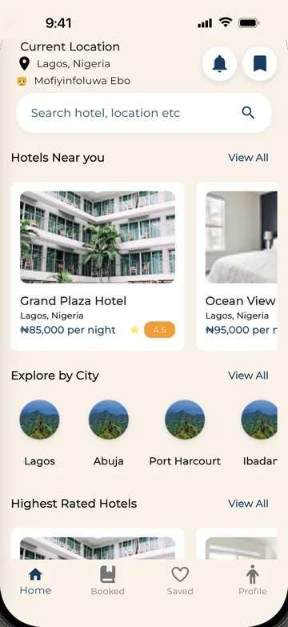
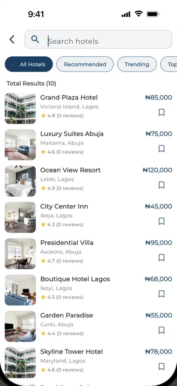
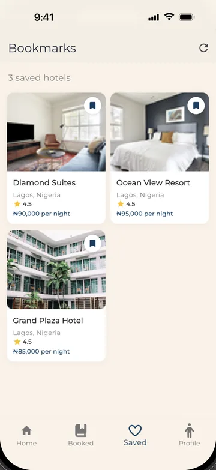
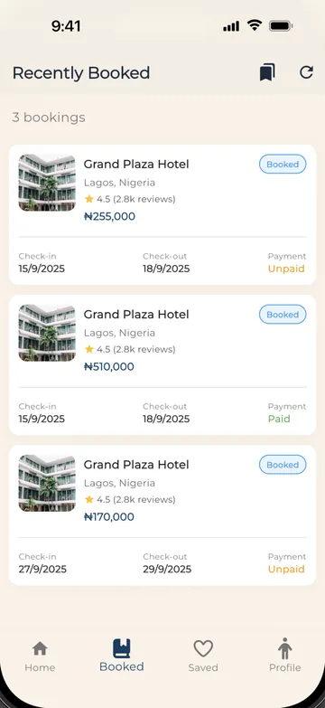
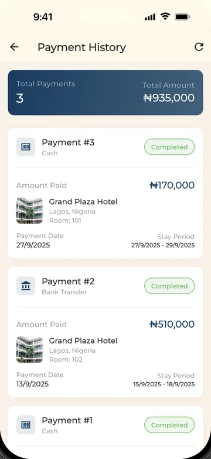

# Lodgix

A Flutter hotel booking app: find a hotel, check availability for your dates, book a room and keep track of your stays and payments.

<p>
  
  
  
  
  
</p>

*Home · Search · Saved hotels · Bookings · Payment history*

## Features

**Accounts**
- Sign up with email and password, then complete a guest profile (full name, phone number, address) and upload an ID document, sent to the API as a multipart form.
- Email verification by one-time code, with resend.
- Log in with email and password; the session token is persisted so returning guests skip the login screen.
- Edit profile details (name, email, phone number, address) and log out, which clears all locally stored session data.

**Discovering hotels**
- Home screen with **Hotels Near You** (hotels in Lagos), **Explore by City** (Lagos, Abuja, Port Harcourt, Ibadan) and **Highest Rated Hotels** (top five by rating), loaded from the API and cached in memory for 10 minutes, with pull-to-refresh.
- City results are filtered from the cached list first and fetched from the API if nothing matches.
- Search screen that matches on name, city or country, with filter chips (All Hotels, Recommended, Trending, Top Rated, Budget) applied on the device.
- Hotel details page with price, rating, amenities and a bookmark toggle, leading into booking.

**Booking**
- Pick check-in and check-out dates, number of guests and number of rooms (room count adjusts automatically at three guests per room); the total is calculated from nightly rate × nights × rooms.
- Before booking, the app asks the API for rooms available on those dates and books the first free one.
- Choose **Payment on Arrival** or **Bank Transfer**; the booking and a matching payment record are created through the API.

**Your stays**
- **Booked:** your bookings with hotel, total, check-in and check-out dates, and Paid or Unpaid status.
- **Saved:** bookmarked hotels, stored per guest on the server, with add and remove.
- **Payment history:** every payment with method, amount, hotel, room and stay period, plus a total count and total amount.

## Tech stack

| Area | Choice |
| --- | --- |
| Framework | Flutter, Dart |
| State management | `provider` (`ChangeNotifier`) |
| Networking | `dio` with a shared interceptor |
| Local storage | `hive` / `hive_flutter`, `shared_preferences` |
| Media | `image_picker` (ID document upload) |
| UI | Material 3 with custom light and dark `ThemeData`, `google_fonts` (Montserrat), `font_awesome_flutter` |
| Backend | Node.js / Express REST API with a SQL database (separate codebase, not in this repository) |

## Architecture

### State management

Lodgix uses **Provider**. `main.dart` registers five `ChangeNotifier`s in a `MultiProvider`:

| Provider | Responsibility |
| --- | --- |
| `UserProvider` | Signed-in guest's details, persisted to a Hive box; logout clears Hive, `SharedPreferences` and the auth token |
| `HotelProvider` | All hotels, nearby and highest-rated lists, 10-minute cache, city lookup |
| `BookmarkProvider` | Saved hotels for the current guest |
| `BookingProvider` | The guest's bookings |
| `ThemeProvider` | Light or dark `ThemeMode` |

Screens read providers with `Consumer` / `Provider.of`, and providers call the service layer. On launch, the splash screen checks for a stored session and, if one exists, preloads bookings and bookmarks in the background before opening the dashboard.

### Layers

```
screens / widgets  ->  providers (ChangeNotifier)  ->  services  ->  request.dart (Dio)  ->  REST API
```

- **`lib/screens`**: one file per screen (auth flow, dashboard, search, hotel details, date selection, payment, bookings, bookmarks, profile).
- **`lib/providers`**: app state, as above.
- **`lib/services`**: one class of static methods per resource (`GuestService`, `HotelService`, `BookingService`, `BookmarkService`, `PaymentService`, `RoomService`), plus `UserSession` for the stored user and token.
- **`lib/request.dart`**: the single HTTP layer.
- **`lib/models`**: `json_serializable` model classes (`Hotel`, `Room`, `Booking`, `Payment`, `Guest`, `Bookmark`, `User`, `RoomService`) with generated `*.g.dart` files. The services and providers currently pass API data around as `Map<String, dynamic>`.

### Talking to the API

- **Base URL:** a hard-coded `host` constant at the top of `lib/request.dart`, currently set to an ngrok tunnel used during development, with a commented-out LAN address as the alternative. There are no environment files or build flavours.
- **Request layer:** `RequestService` wraps one static `Dio` instance with 30-second connect and receive timeouts and an interceptor that sets JSON headers and logs requests and responses. It exposes `get`, `post`, `put`, `patch` and `delete`, each returning the decoded JSON map. Error responses are returned instead of thrown, so callers check `response['status'] == 'success'`.
- **Auth:** on login the API returns a token and the user record. The token is kept in memory, saved to a Hive box (`auth`) and mirrored in `SharedPreferences` with the user record, then reloaded at startup. The interceptor adds an `Authorization: Bearer` header for paths under `/api`, and `delete` always sends it.
- **Uploads:** guest registration uses a separate `Dio` request with `FormData` and 60-second timeouts so the ID document can be sent as a multipart file.
- **Endpoints used** (all relative to the host): `/users/guests` (register), `/users/guests/verify-email`, `/users/guests/resend-otp`, `/users/guest/login`, `/guests/:id` (update profile), `/users/hotels` (list and `?city=`), `/users/rooms/available`, `/users/bookings`, `/users/bookings/guest/:id`, `/users/payments`, `/users/payments/guest/:id`, `/users/bookmarks`.

## Getting started

### Prerequisites

- Flutter SDK with **Dart `^3.7.2`** (the constraint in `pubspec.yaml`; Flutter 3.29 or later).
- An Android emulator, iOS simulator or physical device.
- A running instance of the Lodgix backend API. It is not part of this repository.

### Run

```bash
git clone https://github.com/mofixiu/lodgix.git
cd lodgix
flutter pub get
flutter run
```

### Configuration

The app has no `.env` file or build-time configuration. To point it at your own backend, edit the `host` constant in `lib/request.dart`:

```dart
const host = "http://<your-backend-host>:3000";
```

The development tunnel in the repository is unlikely to still be live, so without a reachable backend the app cannot sign in or load hotels.

## Project structure

```
lib/
├── main.dart              # Hive + RequestService init, MultiProvider, MaterialApp
├── request.dart           # Dio client, interceptor, auth token storage
├── models/                # json_serializable models + generated *.g.dart
│   ├── booking.dart
│   ├── bookmark.dart
│   ├── guest.dart
│   ├── hotel.dart
│   ├── payment.dart
│   ├── room.dart
│   ├── roomservice.dart
│   └── user.dart
├── providers/
│   ├── booking_provider.dart
│   ├── bookmark_provider.dart
│   ├── hotel_provider.dart
│   ├── theme_provider.dart
│   └── user_provider.dart
├── screens/
│   ├── login.dart, signup.dart, basicInfo.dart, otp_verification.dart
│   ├── forgotPassword.dart, otpforgotpassword.dart, createNewPassword.dart
│   ├── dashboard.dart, hotel_search_screen.dart, hotel_details.dart
│   ├── DateSelect.dart, payment.dart, paymentInfo.dart
│   ├── bookedScreen.dart, bookmarks.dart
│   └── profile_screen.dart, edit_profile.dart, notifications.dart
├── services/
│   ├── booking_service.dart
│   ├── bookmark_service.dart
│   ├── guest_service.dart
│   ├── hotel_service.dart
│   ├── payment_service.dart
│   ├── room_service.dart
│   └── user_session.dart
├── themes/
│   └── theme.dart         # Lodgix light and dark ThemeData
└── widgets/
    ├── bottomNavBar.dart
    ├── customButton.dart
    ├── image_picker_widget.dart
    └── splash_screen.dart
```

## Credits

Built in 2025 by a two-person team.

**Mofiyinfoluwa Ebo**, lead mobile developer: [mofiyinebo.com](https://mofiyinebo.com) · GitHub [@mofixiu](https://github.com/mofixiu)
